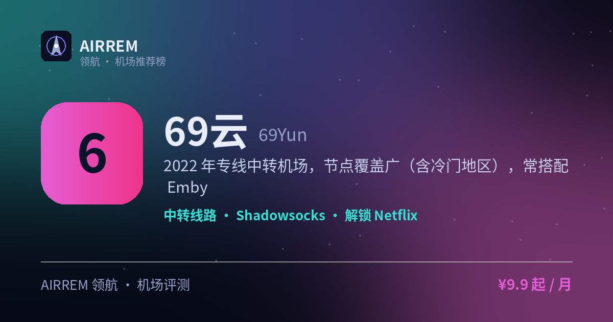

# 69云机场评测 2026：冷门地区 / Emby 影音，官网注册入口与套餐价格

> 2022 年专线中转机场，节点覆盖广（含冷门地区），并提供 Emby 影视库，装上客户端登录即看，追剧党友好。
>
> 最适合：**冷门地区 / Emby 影音**。

👉 **[69云 官网注册入口](https://t.rtxk.us/t/fdr3mkg)** ｜ [完整评测与横向对比](https://555736.xyz/yun69/)

---

## 基本信息

| 项目 | 内容 |
| --- | --- |
| 机场名称 | 69云 |
| 成立时间 | 2022 |
| 线路类型 | 专线中转 |
| 支持协议 | Shadowsocks / VMess |
| 流媒体解锁 | Netflix / Disney+ / HBO / ChatGPT / Emby 影视库 |
| 节点地区 | 亚洲 · 欧美 · 含多个冷门地区 |
| 计费方式 | 包月 / 按量 |
| 起步价格 | ¥9.9 / 月 |
| 推荐场景 | 想要冷门地区节点，还想要 Emby 影视库追剧 |
| Emby 影音 | 支持 |

## 优点与缺点

**✅ 优点**

- 节点多、覆盖冷门地区
- 提供 Emby 影视库，追剧党友好
- 计费灵活

**⚠️ 缺点**

- 欧美等远距离节点速度一般
- 机场行业存在跑路风险，建议先用月付或小额套餐验证稳定性，别一上来就大额年付。

## 69云是什么

69云成立于 2022 年，是一家专线中转机场，节点覆盖广，并提供 Emby 私人影视库等增值内容，追剧观影一步到位。

## 线路 · 协议 · 解锁

除常见热门地区外还覆盖一些冷门地区，亚洲节点较快、欧美中等；支持 SS/VMess，官方称解锁 Netflix、Disney+、HBO、ChatGPT。

- 专线中转，节点数量较多
- 含冷门地区节点
- 协议：SS / VMess
- 提供 Emby 影视库，登录即看，追剧免找片源

## 69云 套餐价格

| 套餐 | 价格 | 说明 |
| --- | --- | --- |
| 月付 | ¥9.9 | 400GB/月 |
| 月付 | ¥16.9 | 800GB/月 |
| 月付 | ¥26.9 | 1600GB/月 |
| 月付 | ¥29.9 | 2000GB/月 |

> 价格来自第三方测评，部分套餐为 2 倍率（实际可用减半），以官网为准。

## 常见问题

**Q：69云的冷门节点靠谱吗？**

A：是其特色，但速度/稳定性通常弱于热门地区，按需实测。

**Q：Emby 服务稳定吗？**

A：属增值内容，可能随时调整或下线，以官网说明为准。

## 适合谁 / 不适合谁

| 👍 适合 | 👎 不适合 |
| --- | --- |
| 有冷门地区节点需求的用户 | 对欧美线路速度要求很高的用户 |
| 想要稳定备用+签到攒流量 |  |

## 我们的结论

节点覆盖面广、冷门地区有优势，套餐多样，还提供 Emby 影视库——登录即看片，稳定、速度快，UP 主在用，适合主力或备用；建议先低价月付验证晚高峰与解锁，再考虑长期。

## 同类机场推荐

拿不定主意？可以再看看这几家同类型的：

- **[守候](https://555736.xyz/shouhou/)** — 稳健老用户 / Emby 影音，¥15 起
- **[自由猫](https://555736.xyz/freecat/)** — 日常主力，¥6 起
- **[淘气兔](https://555736.xyz/taoqitu/)** — 联通移动用户，¥7.8 起

全部 38 家机场的横向对比与选购方法论：**[信号塔 SignalTower · 机场大全](https://555736.xyz/airports/)**

---

数据更新：2026-07 ｜ 价格、套餐与优惠码以官网实时为准 ｜ 本仓库为第三方评测整理，与 69云 官方无隶属关系 ｜ 请遵守当地法律法规使用网络服务。

关键词：69云、专线机场、冷门地区机场、Emby机场、Emby影视库、Emby影音机场、影音机场、追剧机场、机场推荐、机场评测
